<p align="center">
  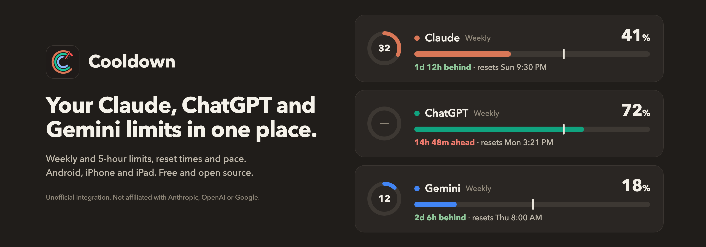
</p>

# Cooldown

Cooldown shows how much of your Claude, ChatGPT and Gemini plan limits you have used, and when they reset. It reads your own accounts and puts the weekly and 5-hour limits on one screen. It runs on Android, iPhone and iPad, and it is free and open source. Listed as EAM360 Cooldown on TestFlight.

> Unofficial integration. Not affiliated with Anthropic, OpenAI or Google.

## Get it

Cooldown is in beta. Get the Android build from GitHub Releases and the iPhone and iPad build from TestFlight. We plan to release on Google Play and the App Store once Anthropic, OpenAI and Google have each reviewed and approved how Cooldown reads plan usage from their services.

- **Android:** download the APK from [GitHub Releases](https://github.com/robineam360/Cooldown/releases).
- **iPhone and iPad:** join the beta on [TestFlight](https://testflight.apple.com/join/TncpZQFM). The current build is 2.0 (3). It is available until 17 Feb 2027.

Beta users: please report feedback through [GitHub Issues](https://github.com/robineam360/Cooldown/issues).

## What you see

### Summary

With two or more accounts, the app opens on a page that lists every account. Each one shows its weekly window, ranked by how much room you have for the time left. You can sort the list and filter it by Personal or Work.

### Pace map

The Pace map plots each account against its own week. Switch on figures, trails or a projection to see more. Tap a dot to open that account.

### Time ahead or behind

Under every window, one line compares your use with an even pace. "1d 12h behind · resets Sun 9:30 PM" means you have used less than an even pace would have by now. "14h 48m ahead" means you have used more. Behind shows in green and ahead in red. This works for the weekly windows.

### Two accounts in one notification

The always-on notification can carry two accounts side by side. Each account has its own ring and its own weekly bar. Expand the notification to see both reset times and refresh with one tap.

### The 5-hour ring and the weekly bar

The weekly window is the bar and the big figure. The 5-hour window is a ring beside it, where the plan has one. OpenAI suspended the 5-hour limit for many ChatGPT plans, and Cooldown shows only what an account reports.

### Widgets

Home-screen widgets show one account or all of them, as a ring, a number, a countdown or a row of rings. Each widget fills whatever size you give it. iPhone and iPad also have lock-screen widgets, a Live Activity and a Control Center control.

### Polish

Tag accounts as Personal or Work. Use light or dark themes, a compact or comfortable layout, and layouts made for foldables and iPad. Share the Summary as one image. Names show in it and email addresses never do.

<p align="center">
  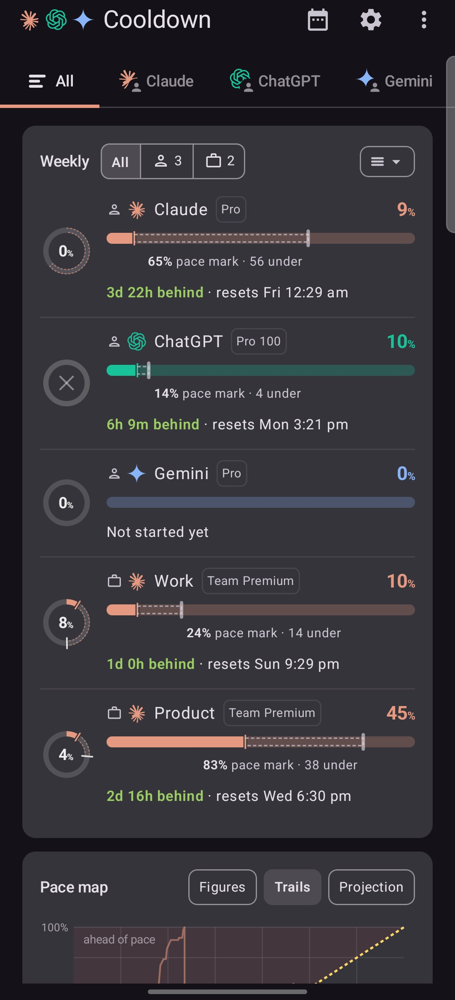
  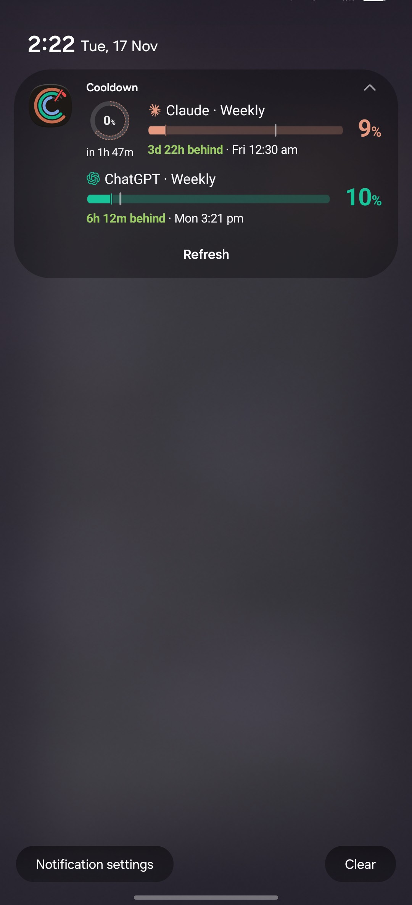
  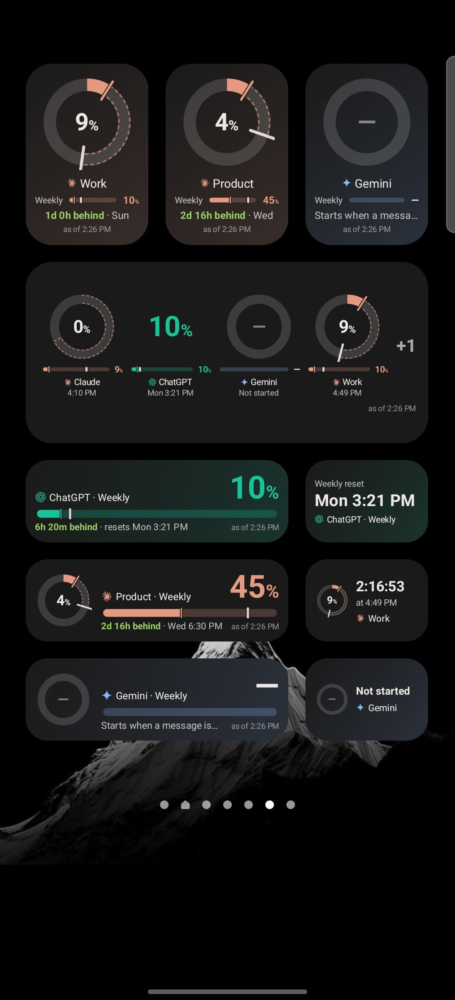
</p>

## What it reads

Cooldown only reads. It sends no prompts and uses no quota. It has no server. Your sign-ins stay on your device, encrypted, and go only to the service they belong to.

## Before you install

None of the three services offers a public way for an app to read your plan usage. Cooldown signs in the way each service's own command-line tool does, on that service's own page, and reads the usage numbers its apps show. For Gemini it must also send that tool's identifier, so this sign-in is the least certain of the three. No provider has approved this. A provider can change or close this route at any time, sign Cooldown out, or act on an account that uses it. Use it at your own discretion.

## Set up in two minutes

Install the app first. On Android, open the APK and allow installs from unknown sources if your phone asks. On iPhone and iPad, open the TestFlight link.

**Claude** (Pro, Max or Team plan)
1. Open Settings, then Accounts, and tap "Sign in on this phone".
2. Log in on Claude's page in your browser and tap Authorize.
3. Copy the code the page shows.
4. Return to Cooldown, tap Paste, then tap Finish sign-in.

**ChatGPT**
1. Tap "+ Add account", then ChatGPT.
2. Open the address the app shows, on this phone or on another device.
3. Type the short code and approve.
4. The app closes the sheet and shows your numbers.

**Gemini**
1. Tap "+ Add account", then Gemini.
2. Sign in on Google's page in your browser and approve.
3. Copy the code the page shows.
4. Return to Cooldown and paste it.

To turn on the notification, open Settings, then Alerts, then Always-on notification. Pick a first account and, if you like, a second.

## Docs

- [User Guide v2.0 (PDF)](release/docs/Cooldown-User-Guide-v2.0.pdf)
- [Brochure (PDF)](release/docs/Cooldown-Brochure.pdf)
- [Privacy policy](docs/privacy.md)

## Feedback

Found a bug or want a feature? Open an issue on [GitHub Issues](https://github.com/robineam360/Cooldown/issues).

## Credits and licence

Made by Robin Richard Rajan, EAM360. Licensed under the [MIT License](LICENSE).

Claude, ChatGPT and Gemini are trademarks of their owners.

<details>
<summary>Every feature in full</summary>

- Gemini accounts. Choose "+ Add account", then Gemini, sign in on Google's own page and paste the code it shows. A Gemini account gets the same cards, charts, notification, widgets and pings, with its plan on the card. If Google changes what it returns, the app says so and keeps your last reading (CCRM-55 (Antigravity Account)).
- Weekly first, and your pace. The weekly window heads every card, the notification and the widgets, with the 5-hour window as a small ring. Each account's Headline (Weekly, 5-hour or Auto) can put 5h first again. One pace line under every window says how far ahead or behind you are and when it resets. Usage display, Vs pace, shows the big figure as your distance from the pace mark (CCRM-96 (Weekly First), CCRM-97 (Pace Number), CCRM-100 (Vs Pace Display), CCRM-102 (Spent Week Gate), CCRM-104 (Pace Line Parity), CCRM-108 (Reset Named)).
- The Summary. With two or more accounts the app opens on All, ranked by the most room for the time left, with a sort menu. The Pace map has Figures, Trails and Projection layers. Tag accounts Personal or Work and filter by either. Share snapshot sends the Summary as one image (CCRM-98 (Summary Tab), CCRM-109 (Quiet Accounts), CCRM-110 (Account Tags), CCRM-111 (Map Layers), CCRM-112 (Summary Snapshot)).
- Charts. A column per day on every 7-day chart, one per hour on 5-hour charts, a 7d chip, and a Show model limits switch (CCRM-107 (Day Grid), CCRM-106 (7d Chip), CCRM-99 (Model Limits Toggle)).
- The always-on notification. The weekly window is the bar and big figure, with the 5-hour window as a ring on the left. Two accounts give two rings and two stacked bars. The widgets follow the same shapes (CCRM-103 (Hybrid Notification), CCRM-105 (Duet Stack)).
- Try with sample data. Three made-up accounts, one per service, on every tab. Nothing is fetched, sent or saved (CCRM-113 (Sample Port)).
- A launcher icon about the weekly limit (CCRM-101 (Icon v3)).
- iPhone and iPad. A public beta on TestFlight with the Summary, home-screen and lock-screen widgets, reset alerts, a Live Activity and a Control Center control (CCRM-94 (iOS App)).
- Widgets on Android. Four faces under Cooldown in the picker: Ring (one account as a gauge), Number (the big percentage), Countdown (when the window comes back) and All accounts (each account as its own ring, never a sum). Each fills the size you place it at, from 1x1 to a full row (CCRM-78 (Widgets Reborn), CCRM-79 (Ring Face), CCRM-80 (Number Face), CCRM-81 (Countdown Face), CCRM-82 (Accounts Strip), CCRM-83 (Ring Renderer), CCBG-44 (Widget Fill)).
- Accounts show their email under the name in Settings, Accounts, and first in Details. Clear usage history starts an account's trend over without removing it (CCBG-34 (Account Display Name), CCRM-14 (Clear History)).
- Share snapshot from the main screen's menu: a square image of the ring, the bars with pace and resets, and the 5h trend (CCRM-24 (Share Card)).
- Density. A switch in Settings, Appearance, folds every card to a title, a bar and one line, or keeps the fully open Comfortable layout. The Main screen layout sheet reorders, hides or tucks cards behind "More", per account.
- Chart height (Small, Medium or Large) and a Time down option that turns the chart on its side so its curve lines up under the bar's pace mark.
- The 7-day chart can read a per-model cap, such as Fable, as well as the pool.
- A short Accounts tab with a Reorder sheet for dragging accounts into your order.
- Plan Fit on the History screen reads your last several closed weeks and says whether your plan fits how you use it.
- The always-on notification runs as a foreground service, so it keeps its place and keeps refreshing.
- Two accounts on one notification. Each half has its provider's mark, the account name, a bar with the even-pace tick and a big percentage in a warning colour. Each half opens that account.
- A status-bar ring fills with the shown account's 5-hour window in that account's colour. Choose First, Second or Whichever is higher.
- Reset pings per account: a 5h reset and a Weekly reset, each Off, If busy or Always. They fire for an account left idle across the reset.
- Claude, ChatGPT and Gemini accounts side by side, each with its provider's mark and colour, which you can override per account.
- A plan tag on every card: Free, Pro, Max, Team Standard or Team Premium for Claude, Plus or Pro for ChatGPT. A Free Claude account is told plainly that Claude reports no usage for it.
- Settings in four tabs: Accounts, Alerts, Appearance and More.
- A pace chart with a burn-rate projection, built from a local history of your own polls, and an even-pace line on every chart and a tick on every bar.
- Usage history: a bar per 5-hour session, week by week.
- Editable account names, and a window an account does not have is not shown.
- Pay-as-you-go usage credits as a card on the main screen, hidden for plans without a credit budget. ChatGPT accounts show a plain balance.
- 15 theme colours, including Material You and Per provider, with light and dark themes. Usage bars shade yellow, orange, then red as you near 100%.

</details>

<details>
<summary>Sign-in, step by step</summary>

**Claude.** Tap Settings, Accounts, then "Sign in on this phone" on the account card. Your browser opens Claude's sign-in page. Log in and tap Authorize. Copy the code the page shows, return to the app, tap Paste, then Finish sign-in. Usage loads at once on a Pro, Max or Team plan. A Free account signs in but gets no numbers, because Anthropic's usage endpoint refuses it. The card says so.

**ChatGPT.** Tap "+ Add account", then ChatGPT. The app shows a short code and a countdown. Open auth.openai.com/codex/device on this phone with the "Open in browser" button, or on another device. Type the code and approve. The sheet closes by itself and the new tab appears with your numbers. The phone mints its own sign-in, and nothing is copied from a computer.

**Gemini.** Tap "+ Add account", then Gemini. Your browser opens Google's own sign-in page. Sign in and approve, then copy the code the page shows. Return to the app and paste it. The new tab appears with your numbers.

**More than one account.** Tap "+ Add account" as many times as you like and mix the services freely. If you keep each Claude account logged in in a different browser, the browser picker routes each sign-in to the right one.

**Notification.** Open Settings, Alerts, Always-on notification, then pick a First and, if you like, a Second account under Show accounts. Set each account's 5h reset and Weekly reset pings on the same tab.

**Renewal.** A Claude sign-in renews itself for about a month, and the app reminds you before it lapses. A ChatGPT sign-in has no fixed expiry the app can predict, so it tells you if a refresh fails.

</details>

<details>
<summary>How it works</summary>

Each account carries the service it belongs to, and the app uses that service's fetcher behind one shared interface. Everything above that, such as tabs, the notification, reset pings and history, does not depend on the service.

**Claude.** The app signs in with the OAuth client of the Claude Code command-line tool, using browser sign-in with PKCE against `claude.com` and `platform.claude.com`. Version 2.0 asks for the `user:profile` scope only, so the token cannot send prompts. To read usage, the app calls an undocumented endpoint, `api.anthropic.com/api/oauth/usage`, and sends `User-Agent: Cooldown/<version> (Android)`. Anthropic's token endpoint blocks requests whose agent looks like `claude-code`, so the token call sends the network library's own agent. Once a day the app reads `api/oauth/profile` on the same host, which names the plan. A Free account gets a 403 `oauth_not_allowed_for_organization` from the usage endpoint. The app then stops polling usage for that account and reads the profile until the plan changes.

**ChatGPT.** Sign-in is OpenAI's device-code flow, the one the Codex command-line tool uses. The app asks `auth.openai.com` for a short code, you approve it in any browser, and the app exchanges the result for its own token. It uses that tool's client ID and sends `User-Agent: Cooldown/<version> (Android)`. Usage comes from `chatgpt.com/backend-api/wham/usage`, which is undocumented. The app never imports a token from a desktop `auth.json`, because reusing that token family would sign you out of your own command-line tool. It never calls the nearby endpoint that would spend a credit, and it never sends the header that reserves capacity.

**Gemini.** Sign-in uses the public OAuth client of Google's Antigravity command-line tool, on `accounts.google.com`, with a code you paste. Tokens go to `oauth2.googleapis.com`. Usage comes from `daily-cloudcode-pa.googleapis.com`, which is undocumented. Requests send `Cooldown/<version>` followed by that tool's identifier, because Google returns Gemini usage only to that identifier.

**Polling.** All services poll on the same battery-friendly interval. The default is 15 minutes, with a floor of 5 minutes. Every poll refreshes the notification. A reset ping is scheduled at the known reset time, and an idle account's window rolls over on the first poll after it. The parsers are lenient, and the app may break without notice if a service changes a payload.

**Storage.** Tokens stay on your device, encrypted with the Android Keystore (`EncryptedSharedPreferences`, AES-256-GCM). On iPhone and iPad they sit in the Keychain. They go to Anthropic, OpenAI and, for Gemini, Google, and nowhere else. There are no servers, no analytics and no third-party network calls. Diagnostics logs record outcomes and status codes, never tokens or headers. A crash report stays on your phone until you share it. The GitHub build also asks GitHub's releases API whether a newer version exists and sends no account data. The [privacy policy](docs/privacy.md) lists every host and everything the app keeps.

</details>

<details>
<summary>Build from source</summary>

You need JDK 21 to build and run the tests, and the Android SDK (compileSdk 36). The app targets Java 17 bytecode.

```bash
./gradlew assembleGithubDebug
# APK lands in app/build/outputs/apk/github/debug/
```

The stack is Kotlin, Jetpack Compose (Material 3), WorkManager and OkHttp. The notification is plain RemoteViews. The iPhone and iPad app is in `ios/`. See [RELEASING.md](RELEASING.md) for the release workflow.

</details>

<details>
<summary>Version history</summary>

A plain-English tour of each update, newest first. The full changelog is in the [User Guide](release/docs/Cooldown-User-Guide-v2.0.pdf).

- **2.0**: **Gemini, Weekly first with your pace, the Summary, and iPhone and iPad.** Cooldown
  now reads **Gemini** as well as Claude and ChatGPT: **+ Add account → Gemini**, sign in on
  Google's own page, paste the code (CCRM-55 (Antigravity Account)). The weekly window now heads
  every card, the notification and the widgets, with the 5-hour window as a small ring beside it;
  each account's **Headline** can put 5h first again, and one pace line under every window says
  how far ahead or behind you are and when it resets (CCRM-96 (Weekly First), CCRM-97 (Pace
  Number), CCRM-104 (Pace Line Parity), CCRM-108 (Reset Named)). **Usage display → Vs pace**
  shows the figure as your distance from the pace mark (CCRM-100 (Vs Pace Display)), and a spent
  week greys out the 5-hour window with a note on when it returns (CCRM-102 (Spent Week Gate)).
  With two or more accounts the app opens on the **Summary**: every account's week ranked on one
  page, a **Pace map**, **Personal** and **Work** tags, and a **Share snapshot** image (CCRM-98
  (Summary Tab), CCRM-109 (Quiet Accounts), CCRM-110 (Account Tags), CCRM-111 (Map Layers),
  CCRM-112 (Summary Snapshot)). Charts get a column per day and a **7d** chip, with a **Show
  model limits** switch (CCRM-107 (Day Grid), CCRM-106 (7d Chip), CCRM-99 (Model Limits
  Toggle)). The always-on notification uses the weekly bar with a 5-hour ring, and two accounts
  show two rings and two stacked bars (CCRM-103 (Hybrid Notification), CCRM-105 (Duet Stack)).
  **Try with sample data** shows three made-up accounts, with nothing fetched, sent or saved
  (CCRM-113 (Sample Port)). A new launcher icon (CCRM-101 (Icon v3)). **iPhone and iPad:**
  Cooldown 2.0 is a public beta on TestFlight (CCRM-94 (iOS App)). A Gemini account's requests go
  to Google and nowhere else; the [privacy policy](docs/privacy.md) lists the hosts.
- **1.9**: **Crash reports that stay on the phone, a steadier sign-in store, a privacy
  policy.** If Cooldown crashes or stops responding, the next launch shows a card under the top
  bar, *"Cooldown crashed today at 6:17 PM"*, with **Share report** and **Not now**; the
  report goes only where you send it, holds the error's type, the code locations and the app,
  Android and phone versions, and leaves out error messages, tokens and emails. Behind the
  7-tap unlock, **Diagnostics → Crash reports** keeps them for 30 days (CCRM-85 (Crash
  Capture)). A credential store Android can no longer unlock no longer crashes the app at every
  launch: Cooldown clears the unreadable sign-ins, says so, and you sign in again (CCBG-46
  (Keystore Wedge)). When secure storage only stops responding, an amber notice says so on the
  main screen and in Settings → Accounts, with **Try again**; saved sign-ins stay on the phone
  and come back once it answers, and a sign-in or sign-out made meanwhile is named on a
  one-time card after the restart (CCBG-50 (Degraded Store Notice)). A **Privacy policy** row
  on the About card, under Share feedback, lists every host the app talks to and everything it
  keeps (CCRM-89 (Privacy Policy)); the app no longer holds the permission to see every
  installed app, and the browser picker still lists your browsers (CCRM-88 (Scoped Queries)).
  **Fixed:** Settings tab titles are never cut off on a narrow phone or at a large font, the
  row scrolls instead (CCBG-35 (Tab Clip)); the one-account notification says "5h" and
  "Weekly", like the two-account one (CCBG-45 (Single Panel Wording)); a widget's settings
  opened later say "Save changes", not "Add widget" (CCBG-48 (Reconfigure Label)); after a
  reboot the always-on notification comes back promptly, not minutes later (CCBG-52 (Boot Pin
  Delay)).
- **1.8**: **Home-screen widgets are back, and accounts show their email.** Four widgets in
  the picker under **Cooldown**, **Ring** (one account as a gauge), **Number** (the big
  percentage), **Countdown** (when the window comes back, ticking live) and **All accounts**
  (every account as its own ring, side by side, never a sum) (CCRM-78 (Widgets Reborn),
  CCRM-79 (Ring Face), CCRM-80 (Number Face), CCRM-81 (Countdown Face), CCRM-82 (Accounts
  Strip)). Adding one opens its settings, account, window, background, changeable later from
  its long-press **Settings**; every widget **fills whatever size you place it at**, from 1×1
  to a full row, painted by the same ring renderer as the status bar (CCRM-83 (Ring Renderer),
  CCBG-44 (Widget Fill)); widgets placed before v1.6 do not return on their own. Each account
  now shows the **email** it signed in with, under its name in Settings → Accounts and first in
  ⋮ → Details, with Rename suggesting a name from it (CCBG-34 (Account Display Name));
  **Clear usage history…** starts an account's trend over without removing it (CCRM-14 (Clear
  History)). **Share snapshot**, in the main screen's ⋮, turns the ring, the bars and the 5h
  trend into one square image (CCRM-24 (Share Card)). **Fixed:** the two-account notification
  keeps both names whole with their dots (CCBG-24 (Duet Label Clamp), CCBG-37 (Duet Dot
  Squeeze)); the always-on notification no longer crashes with one account (CCBG-31 (Alert
  Crash)); the sign-in card's buttons wrap cleanly on narrow phones (CCBG-32 (Accounts Button
  Wrap)); ChatGPT sign-in names the security setting it needs (CCBG-33 (Device-Code
  Prerequisite)); each account card's ⋮ lines up with its refresh button (CCBG-42 (Kebab
  Drift)).
- **1.7**: **The main screen redesigned, the Accounts tab to match, and a notification that
  stays alive.** The main screen (CCRM-72 (Main Screen Redesign)) gets a **Compact** density
  that folds each card to a title, a bar and one line, tap to open the chart in place, plus a
  **Main screen layout** sheet to reorder, hide or fold cards behind "More" (CCRM-25 (Card
  Layout), CCRM-35 (Layout Reset)), one status line in place of the old Refresh button, a
  **Chart height** setting (Small/Medium/Large, default Medium) and a **Chart orientation**
  toggle that lines the chart's now-line up under the bar's pace mark (CCRM-75 (Chart Height),
  CCRM-77 (Transposed Chart)), the 7-day chart's own **All / per-model** chips (CCRM-73 (Model
  Cap Chart)), and Claude's dark theme going black like ChatGPT's (CCRM-76 (Black Room)). The
  **Accounts** tab is compact too, status dot, plan chip, three action cells, with
  **drag-to-reorder** accounts (CCRM-65 (Accounts Redesign), CCRM-71 (Account Order)). History's
  7-day pane gains **Plan Fit**: is this plan the right size, read off your last several closed
  weeks (CCRM-70 (Plan Fit)). The always-on notification runs as a real **foreground service**
  now, so it stops sinking below other notifications and going stale (CCRM-67 (Pin Service));
  ChatGPT's idle 5-hour window no longer counts down before it's started (CCBG-30 (Phantom
  Window)); and the app finally identifies itself honestly to Anthropic instead of borrowing the
  Claude Code CLI's name (CCRM-68 (Honest Agent)). Diagnostics moves behind the version-tap
  unlock (CCRM-34 (Diagnostics Log)). **Known issue:** CCBG-24 (Duet Label Clamp), a long
  notification label can still clip beside a three-character figure under Left.

- **1.6**: **Two accounts on one notification, Settings on a diet, the Pulse icon.** The
  always-on notification now carries a **First** and a **Second** account side by side, with
  both headers and the Weekly rows when expanded, the expanded panel now draws at full width
  whatever it holds, so a warning strip can no longer scale the Weekly meters down with it
  (CCBG-26 (Panel Scaling)); the status-bar ring drops its weekly dot and wears the shown
  account's colour (First / Second / Whichever is higher), solid red with an × at 100%.
  **Reset pings** are per account and per window, and fire for an idle account too.
  Settings shrinks to **four tabs**, Accounts, Alerts, Appearance, More. Every Claude card
  wears its plan, **Free, Pro, Max, Team Standard, Team Premium**, read from Anthropic's
  profile endpoint (CCRM-64 (Claude Plan Tag)), and a **Free** account is told plainly that
  Claude reports no usage for it, instead of "Anthropic's server errored" (CCBG-27 (Free Plan
  403)). The **computer-token backup** (paste / Scan QR and the in-app token guide) is
  removed: signing in happens on the phone, for both services (CCRM-63 (Token Import
  Removal)). A new **Pulse** launcher icon, and each tab is a **room**: ivory and serif for
  Claude, neutral for ChatGPT. **Removed:** the home-screen widgets, the Quick Settings tile,
  the standalone threshold and pace alerts, three notification styles and three status-bar
  glyphs, placed widgets and tiles disappear on update. Fixed: the two provider marks in the
  top bar now render the same size.
- **1.5**: **ChatGPT accounts.** The app is now just **Cooldown**, and tracks Claude *and*
  ChatGPT side by side, add either from "+ Add account", sign into ChatGPT with a short code
  at auth.openai.com (no computer, no copied token), and every tab and alert works the same
  for both. Each service's own mark on every surface; a **Per provider** theme where each
  account wears its own colour, overridable per account. A window an account doesn't have is
  now hidden rather than drawn as a dash. Gemini (Google Antigravity) is listed but greyed
  out, its sign-in can't finish on a phone yet.
- **1.4**: **Multi-account**, "+ Add account" for a third, fourth, or more, each with its own tab and alerts. A new clock-hand pace needle on the always-on notification's status-bar icon. Fixed: alerts switched off in Settings now retract their pinned-notification strip instead of leaving it stuck.
- **1.3**: The status-bar icon rebuilt around its real size, with a theme-coloured pace ring and a dot for when the 7-day window needs a look; every alert for every profile now folds into one pinned-notification panel; new hourglass launcher icon; Used-or-Left and countdown-or-clock display switches.
- **1.2**: Three new widget faces (Ring, Mini-Rings, Pace, since retired); pace marks on every bar and ring; **pace alerts** on the projection, not just the percent (since retired); automatic update checks.
- **1.1**: **Usage credits**, four pinned-notification styles (three since retired), and a rebuilt **pace chart** with an even-pace line and threshold guides.
- **1.0**: First official release, everything below, polished into one build and shared with the team.
- **0.14**: Feedback now opens an email (was WhatsApp); added a **Check for updates** button; the app downloads from GitHub Releases.
- **0.13**: The big one: **usage history**, an always-on **pinned notification**, and **finer-grained alerts**. Profiles are renameable, and your history & settings now survive a reinstall.
- **0.12**: **Sign in right on your phone**, no computer needed. Also fixed a recurring sign-in error.
- **0.11**: Internal build (never released).
- **0.10**: Clearer sign-in error messages and easier token setup.
- **0.9**: **Burn-rate forecast** (when you'll hit the limit at your current pace) + sign in by scanning a QR code.
- **0.8**: Smarter heads-ups when your sign-in is about to expire or the data goes stale.
- **0.7**: Renamed to **Claude Cooldown**, new icon, tidier Settings, in-app help.
- **0.6**: Added the **Work** profile alongside Personal, plus Quick Settings tiles (since retired).
- **0.5**: Big visual refresh, cleaner bars, the pacing indicator, and 13 theme colors.
- **0.4**: First usage alerts and a Quick Settings tile.
- **0.3**: Material You theming and dark-mode polish.
- **0.2**: Bigger widget with exact reset times.
- **0.1**: First working app + widget.

</details>

<details>
<summary>More screenshots</summary>

<table>
  <tr>
    <td align="center" width="33%">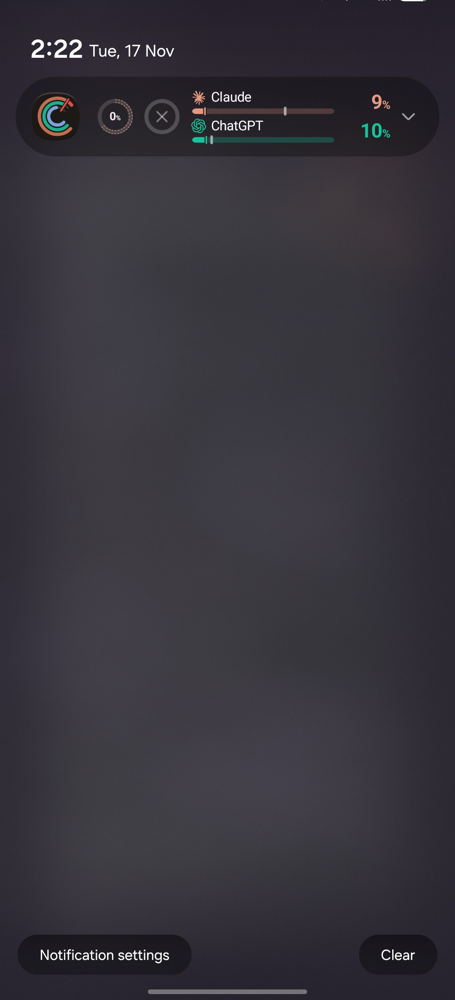<br><sub>The notification, collapsed</sub></td>
    <td align="center" width="33%">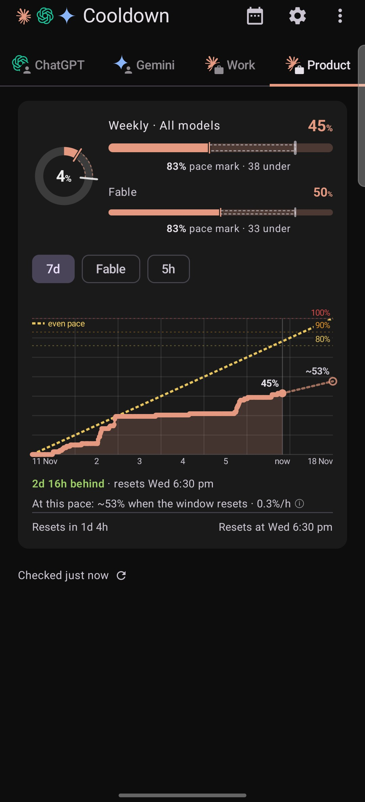<br><sub>An account tab, dark</sub></td>
    <td align="center" width="33%">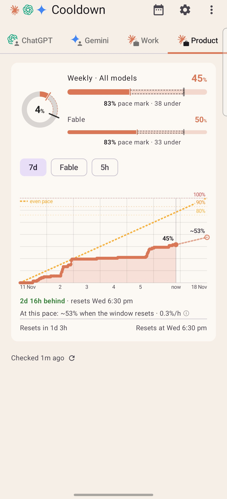<br><sub>An account tab, light</sub></td>
  </tr>
  <tr>
    <td align="center">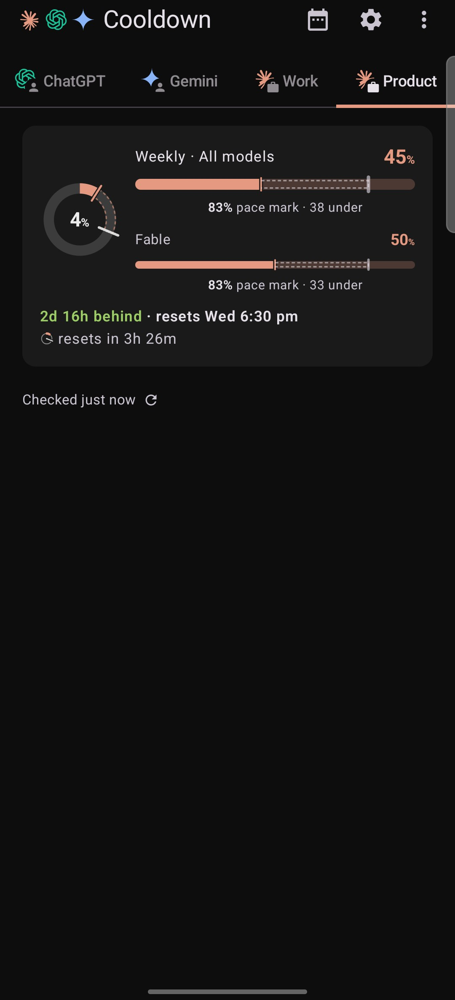<br><sub>Compact density</sub></td>
    <td align="center">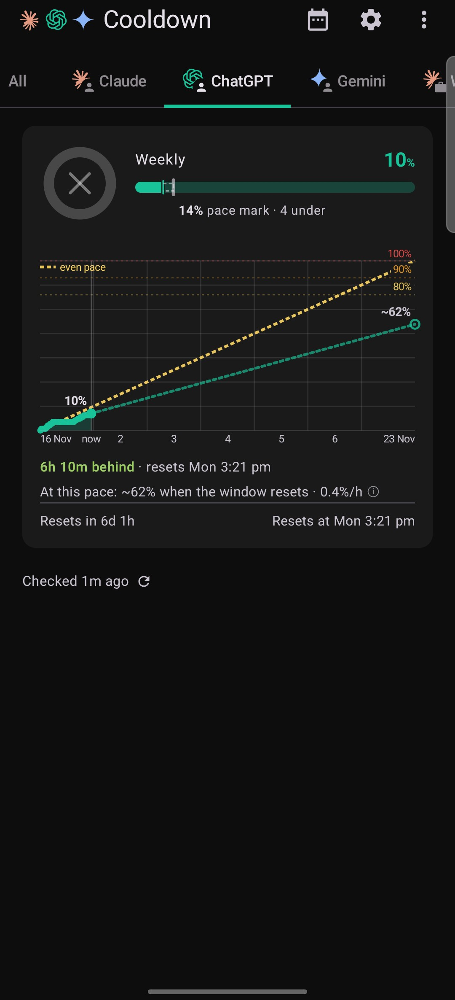<br><sub>A ChatGPT account</sub></td>
    <td align="center">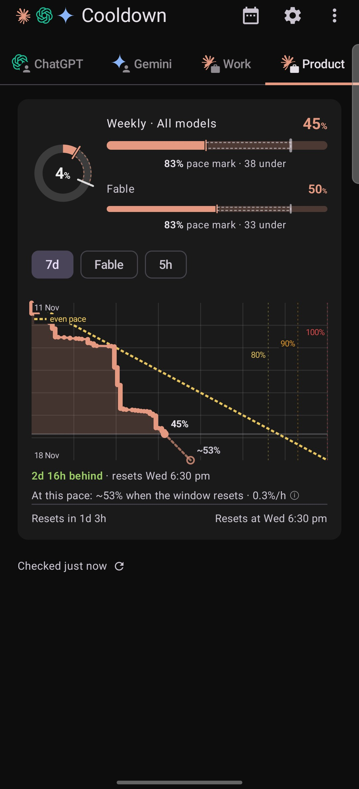<br><sub>Time down chart</sub></td>
  </tr>
  <tr>
    <td align="center">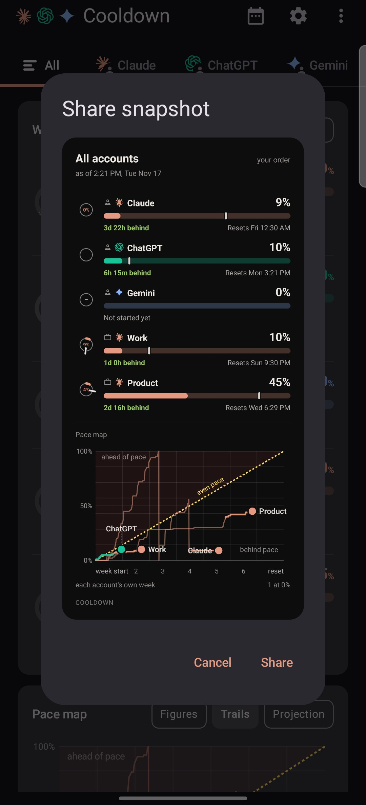<br><sub>Share snapshot</sub></td>
    <td align="center">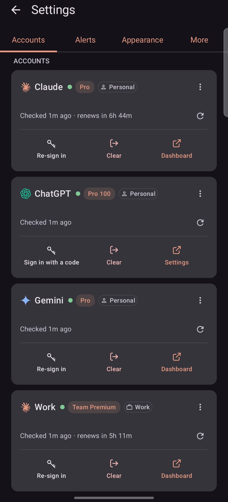<br><sub>Settings, Accounts</sub></td>
    <td align="center">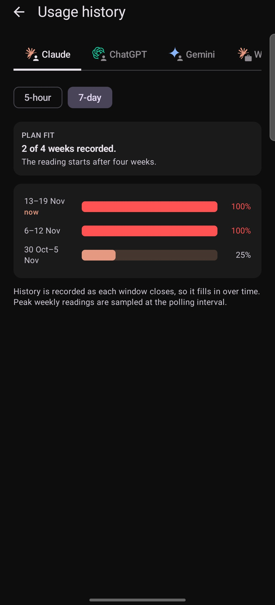<br><sub>Plan Fit on History</sub></td>
  </tr>
  <tr>
    <td align="center">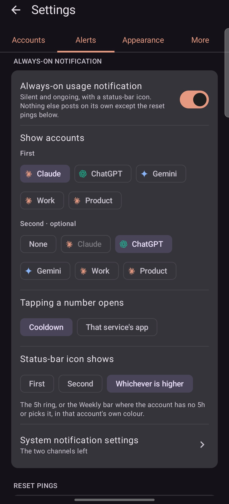<br><sub>Settings, Alerts</sub></td>
    <td align="center">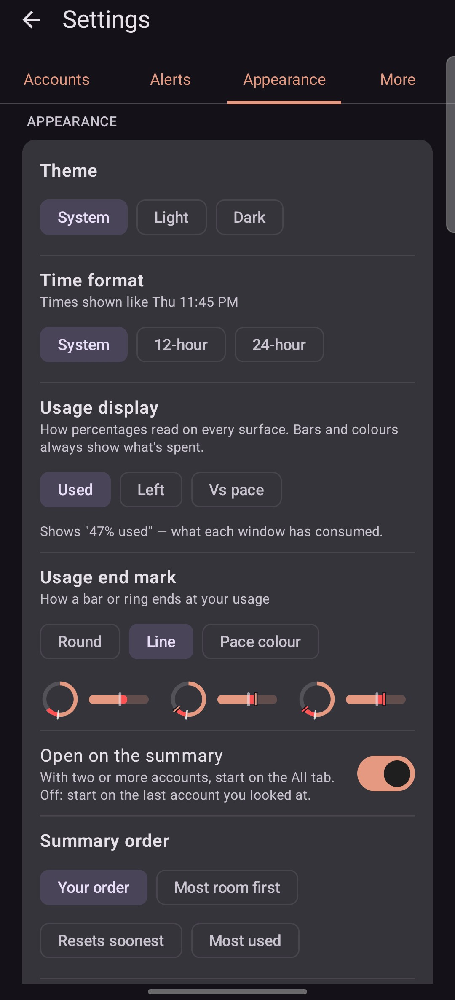<br><sub>Settings, Appearance</sub></td>
    <td align="center">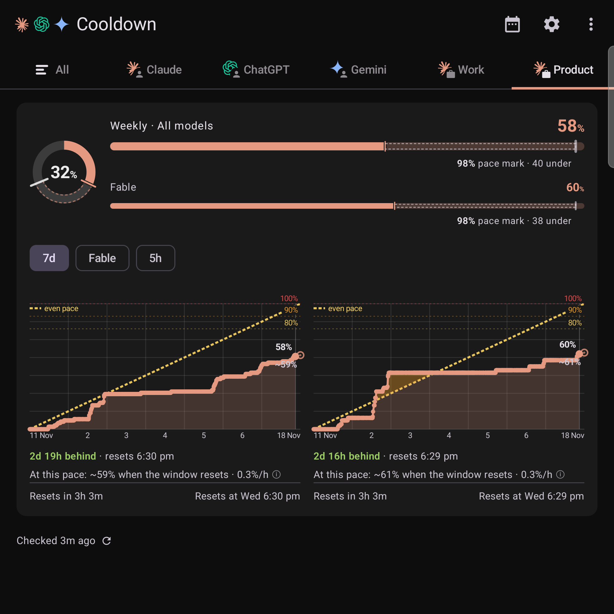<br><sub>Foldable inner screen</sub></td>
  </tr>
  <tr>
    <td align="center">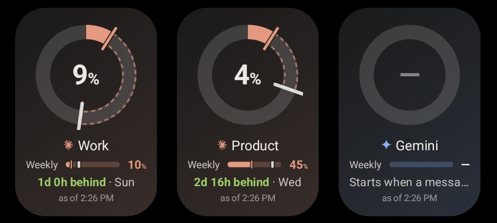<br><sub>Ring widget</sub></td>
    <td align="center">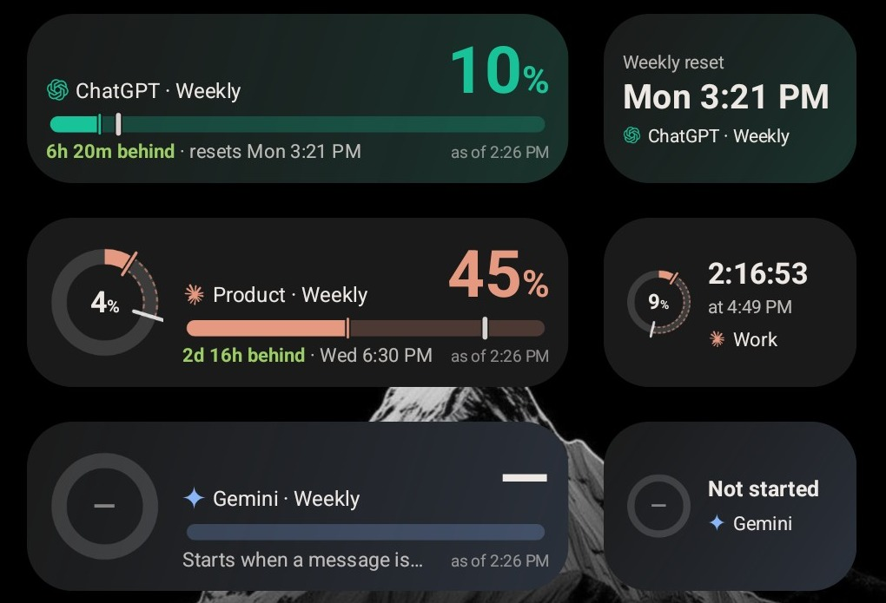<br><sub>Bars widget</sub></td>
    <td align="center">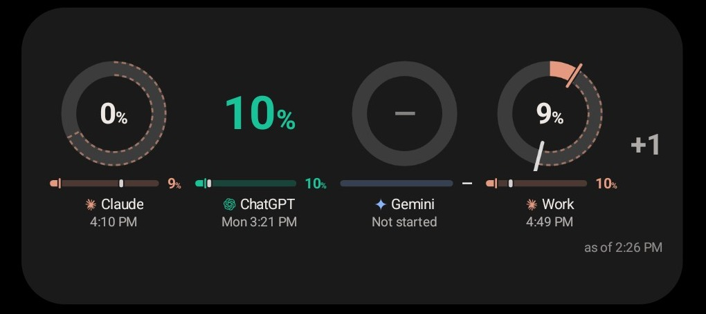<br><sub>Strip widget</sub></td>
  </tr>
</table>

</details>
